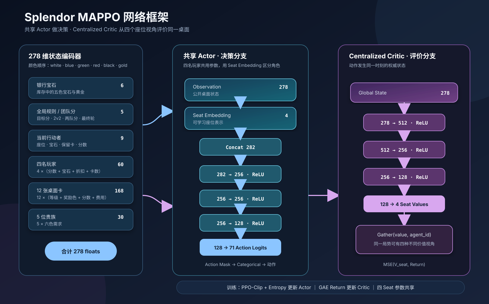
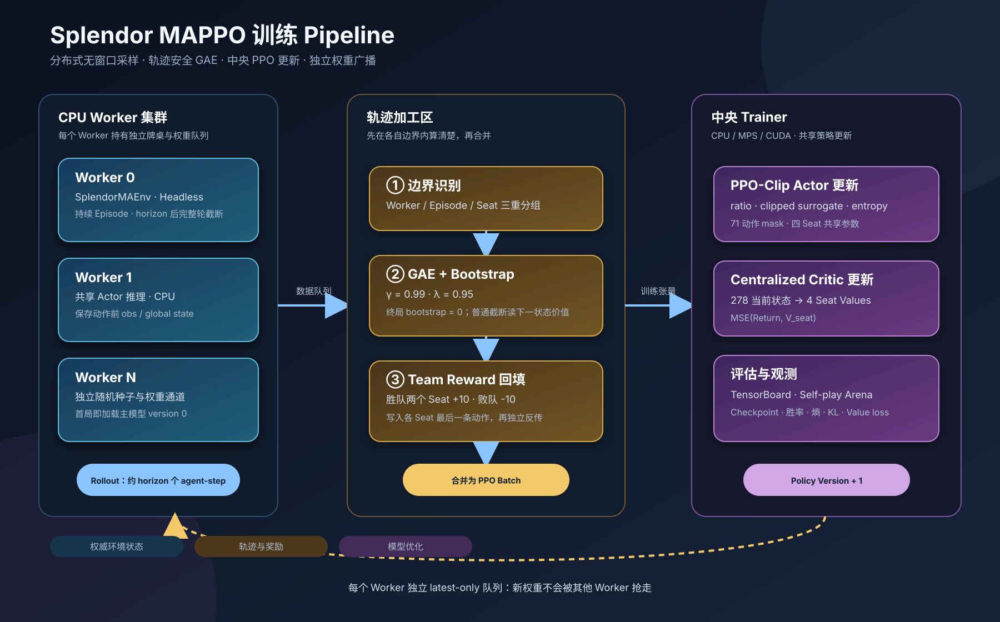

# 璀璨宝石：本地、AI 与局域网对战

基于 `pygame` 的四人《璀璨宝石》实现，使用标准基础版 90 张发展卡（I / II / III 级分别为 40 / 30 / 20 张）和标准贵族条件。

支持：

- 本地热座与启发式 AI；
- 单人竞技（默认 15 分）与 2v2（固定 30 分）；
- OpenAI 兼容的生成式 AI 接口；
- 局域网房间、房主安排座次、延迟显示和断线 AI 接管；
- 实验性的 MAPPO / PPO 自博弈训练框架。

## 运行游戏

```bash
python3 -m venv .venv
.venv/bin/python -m pip install -r requirements.txt
.venv/bin/python main.py
```

### 对局规则

- 单人竞技：各玩家独立计分，默认达到 15 分后完成本轮并结算。
- 2v2：1、3 号位属于 1 队，2、4 号位属于 2 队；团队达到 30 分后完成本轮。
- 点击宝石可拿 3 枚不同色，或在库存不少于 4 时拿 2 枚同色。
- 点击发展卡后可购买或保留，也可以从某级牌库盲抽保留。
- 保留发展卡时，如果库存中还有黄金，可获得 1 枚黄金。
- 宝石超过 10 枚时，必须按提示归还。
- `R` 重开当前配置，`Esc` 返回设置页。

### 生成式 AI（可选）

未配置外部模型时，游戏自动使用本地启发式策略。接入 OpenAI 兼容接口：

```bash
export SPLENDOR_AI_ENDPOINT="https://你的服务/v1/chat/completions"
export SPLENDOR_AI_API_KEY="你的密钥"
export SPLENDOR_AI_MODEL="模型名称"
```

### 局域网联机

1. 房主点击“创建局域网房间”，把大厅显示的 IP 发给朋友。
2. 客人只输入房主 IP，程序固定使用端口 `48527`。
3. 房主给所有玩家安排座次，其余位置由 AI 接管。
4. 房主开始游戏；客人右上角显示实时往返延迟。
5. 客人断线后，对应席位立即由 AI 接管。

设备需位于同一局域网。系统防火墙询问 Python 是否允许接收入站连接时，需要选择允许。

## 代码结构

| 路径 | 职责 |
|---|---|
| `main.py` | 桌面程序入口 |
| `app.py` | Pygame UI、输入、AI 调度和联机会话协调 |
| `game_engine.py` | 无 UI 的游戏模型与规则 |
| `game_ai.py` | 合法动作、策略观测与动作执行 |
| `ai_player.py` | 团队启发式与生成式模型策略 |
| `state_codec.py` | 联机状态序列化和隐私过滤 |
| `network.py` | 局域网 TCP 传输 |
| `rl/environment.py` | 简单的无 UI 单环境接口 |
| `rl/mappo/` | MAPPO / PPO 多进程训练框架 |
| `tests/` | 游戏引擎、策略和训练管线回归测试 |

运行测试：

```bash
.venv/bin/python -m unittest discover -s tests -v
```

---

# 强化学习实验室

把训练想象成一所“宝石学院”：四名学生共用一套决策大脑，在很多张无窗口牌桌上同时练习；中央教练观察完整桌面，为每个座位分别评价局势，然后使用 PPO 更新共享策略。

当前训练框架已经修复：

- 引擎与编码器统一使用 `white / blue / green / red / black / gold`；
- 动作空间改为 71 个无冲突、可逆槽位；
- Critic 使用动作发生同一时刻的权威状态，而不是历史观察拼接；
- 每个 Worker 启动前加载主模型权重，并使用独立的 latest-only 广播队列；
- GAE 按 Worker、Episode、Seat 分组，绝不跨轨迹传播；
- 非终止 horizon 使用下一状态 Critic 值 bootstrap；
- 2v2 终局胜负奖励分别写入四个座位的轨迹。

## 1. 网络结构



> 高清文件：[`SVG`](docs/architecture/mappo-network-architecture.svg) · [`PNG`](docs/architecture/mappo-network-architecture.png)

### 共享 Actor：负责选择动作

```text
278 维观察 + 4 维可学习座位 embedding
                  │
                  ▼
          Linear 282 → 256 + ReLU
          Linear 256 → 256 + ReLU
          Linear 256 → 128 + ReLU
          Linear 128 → 71 logits
                  │
                  ▼
         非法动作 logits 设为 -1e9
                  │
                  ▼
            Categorical 采样
```

四个座位共享同一个 Actor，通过座位 embedding 学习先后手和团队位置差异。

### Centralized Critic：负责评价局势

```text
同一时刻的 278 维权威全局状态
                  │
                  ▼
          Linear 278 → 512 + ReLU
          Linear 512 → 256 + ReLU
          Linear 256 → 128 + ReLU
          Linear 128 → 4 个座位价值
```

为什么输出 4 个价值？同一个桌面对 1 队可能是优势，对 2 队却是劣势。训练时根据当前行动者的 `agent_id` 选择对应价值头，避免让一个标量同时表示互相矛盾的视角。

默认优化参数：

- Actor Adam：`3e-4`
- Critic Adam：`1e-3`
- PPO clip：`0.2`
- Value loss 系数：`0.5`
- Entropy 系数：`0.01`
- 梯度裁剪：`0.5`
- GAE：`γ=0.99`、`λ=0.95`
- 每批更新 4 epochs

## 2. 278 维状态空间：每个数字代表什么

颜色顺序统一为：

```text
[white, blue, green, red, black, gold]
```

### 总览

| 索引 | 维度 | 内容 |
|---|---:|---|
| `0:6` | 6 | 银行宝石 |
| `6:11` | 5 | 全局规则和团队状态 |
| `11:20` | 9 | 当前行动者 |
| `20:80` | 60 | 四名玩家，每人 15 维 |
| `80:248` | 168 | 三级共 12 个桌面卡槽，每卡 14 维 |
| `248:278` | 30 | 五位贵族，每位 6 维 |
| **合计** | **278** | Actor 与 Critic 的状态输入 |

### `0:6`：银行宝石

六个值依次为白、蓝、绿、红、黑、黄金库存。

### `6:11`：全局信息

| 索引 | 含义 | 编码 |
|---:|---|---|
| 6 | 目标分数 | `target / 30` |
| 7 | 是否 2v2 | 0 或 1 |
| 8 | 1 队分数 | `score / 30`，单人模式为 0 |
| 9 | 2 队分数 | `score / 30`，单人模式为 0 |
| 10 | 是否已进入最后一轮 | 0 或 1 |

### `11:20`：当前行动者

| 索引 | 含义 |
|---:|---|
| 11 | 座位号归一化：`seat / 3` |
| 12～17 | 六色宝石数量 |
| 18 | 保留卡数量：`reserved / 3` |
| 19 | 个人分数：`score / target` |

### `20:80`：四名玩家

每位玩家占 15 维，第 `s` 个座位从 `20 + 15×s` 开始：

```text
个人分数 1
+ 六色宝石 6
+ 六色永久折扣 6
+ 已购卡数量 1
+ 保留卡数量 1
= 15
```

座位范围：

- seat 0：`20:35`
- seat 1：`35:50`
- seat 2：`50:65`
- seat 3：`65:80`

### `80:248`：12 个固定桌面卡槽

每层固定保留 4 个槽位，即使牌堆耗尽也在该层内部补零，不会让下一层卡牌“串位”。顺序是：

```text
I 级 4 张 → II 级 4 张 → III 级 4 张
```

每张卡 14 维：

```text
等级/3                       1
奖励颜色 one-hot             6
分数/5                       1
六色费用/7                   6
总计                         14
```

### `248:278`：5 位贵族

每位贵族 6 维，对应六色需求；没有贵族的位置补零。基础版贵族不需要黄金，因此黄金需求通常是 0。

> 当前 Actor 观察的是完整公开桌面状态。后续若加入隐藏信息训练，可通过 `priv_seat` 增加私人保留卡等座位专属信息；Critic 仍使用权威全局状态。

## 3. 71 维动作空间：怎么算出来的

| 槽位 | 数量 | 动作 |
|---|---:|---|
| `0:12` | 12 | 购买桌面卡：3 层 × 4 张 |
| `12:24` | 12 | 保留桌面卡：3 层 × 4 张 |
| `24:27` | 3 | 从 I / II / III 级牌库盲抽保留 |
| `27:30` | 3 | 购买自己的第 1 / 2 / 3 张保留卡 |
| `30:60` | 30 | 拿宝石组合 |
| `60:65` | 5 | 选择第 1～5 位贵族 |
| `65:71` | 6 | 归还六种宝石之一 |
| **合计** | **71** | 固定离散动作空间 |

“拿宝石”的 30 个槽位来自：

```text
拿 1 种不同色：C(5,1) = 5
拿 2 种不同色：C(5,2) = 10
拿 3 种不同色：C(5,3) = 10
拿 2 枚同色：5
合计：5 + 10 + 10 + 5 = 30
```

为什么保留 1 种和 2 种不同色？当银行只剩一两种可用颜色时，规则允许拿完当前可用的不同颜色。

固定映射使用 `(tier - 1) × 4 + position`，避免过去 tier 从 1 开始造成偏移。每一步由 `action mask` 屏蔽当前非法槽位；编码器会检测重复槽位和无法编码的合法动作并立即报错。测试会验证 71 种理论动作与 `0...70` 一一对应并可逆。

## 4. 训练管线



> 高清文件：[`SVG`](docs/architecture/mappo-training-pipeline.svg) · [`PNG`](docs/architecture/mappo-training-pipeline.png)

```text
主进程创建 Actor + Critic
        │
        ├─ 把相同初始权重分别发送给每个 Worker
        │
多个 CPU Worker 并行
        ├─ 持续运行各自的无窗口牌桌
        ├─ 每步保存动作发生前的 obs 与同一时刻 global state
        ├─ rollout 达到 horizon 后，延长到完整轮边界再切分
        ├─ 非终止切分使用下一状态的四座位 Critic 值 bootstrap
        └─ 将 rollout 和 episode 边界发回主进程
        │
        ▼
主进程
        ├─ 分别对每个 Worker / Episode / Seat 计算 GAE
        ├─ 计算完 advantage 后才合并 batch
        ├─ PPO-clip 更新共享 Actor
        ├─ MSE 更新四头 Centralized Critic
        ├─ 写 TensorBoard、评估、保存 checkpoint
        └─ 通过每个 Worker 独立的 latest-only 队列广播新权重
```

关键保证：

- 不会把 Worker A 的奖励接到 Worker B 的轨迹后面；
- 不会把 seat 0 的 advantage 递推到 seat 1；
- horizon 截断不会假装游戏结束；
- Worker 第一局就使用主模型权重，而不是各自随机初始化；
- 某个 Worker 不会“吃掉”本应发给其他 Worker 的权重消息。

## 5. 奖励：AI 什么时候获得反馈

### 逐步奖励

```text
单人模式：当前行动者个人分数变化
2v2 模式：当前行动者所属队伍总分变化
```

获得有分发展卡或贵族时会得到正奖励。拿宝石、购买 0 分卡、保留和阻断通常即时奖励为 0，由价值函数和 GAE 学习其长期作用。

### 终局奖励

```text
获胜座位 / 获胜队伍中的两个座位：+10
失败座位 / 失败队伍中的两个座位：-10
```

奖励会写入每个座位在本局终局段的最后一条动作轨迹，而不是只奖励触发结算的最后行动者。之后 GAE 按座位独立向前传播。

## 6. 本机训练建议

本机为 Apple M5 Pro、18 核 CPU、20 核 GPU、48 GB 统一内存。约 49 万参数的新模型规模很小，硬件足够；主要瓶颈更可能是 Python 环境采样。

训练依赖单独安装：

```bash
.venv/bin/python -m pip install -r requirements-train.txt
```

训练入口会依次选择 CUDA、Apple MPS、CPU。建议先进行极短 smoke run，而不是直接跑百万步：

```bash
.venv/bin/python -m rl.mappo.main_train \
  --mode team --workers 4 --horizon 64 --device mps \
  --timesteps 10000 --save checkpoints/mappo_team.pt --tb-runs runs
```

本次修复没有执行训练，只运行状态编码、动作映射、Worker 采样、GAE、bootstrap、团队奖励和游戏回归测试。

## 7. 仍值得继续改进

- 建立历史 checkpoint 对手池，让策略不只和最新版自己对战；
- 为 Actor 定义真正的私人观察，进一步严格化 CTDE；
- 为长训练加入恢复 optimizer、随机数和训练步数的完整 checkpoint；
- 基准测试本机 `cpu` 与 `mps`，小网络不一定在 MPS 上更快；
- 谨慎评估贵族进度等潜势型 reward shaping，避免改变最优策略。
