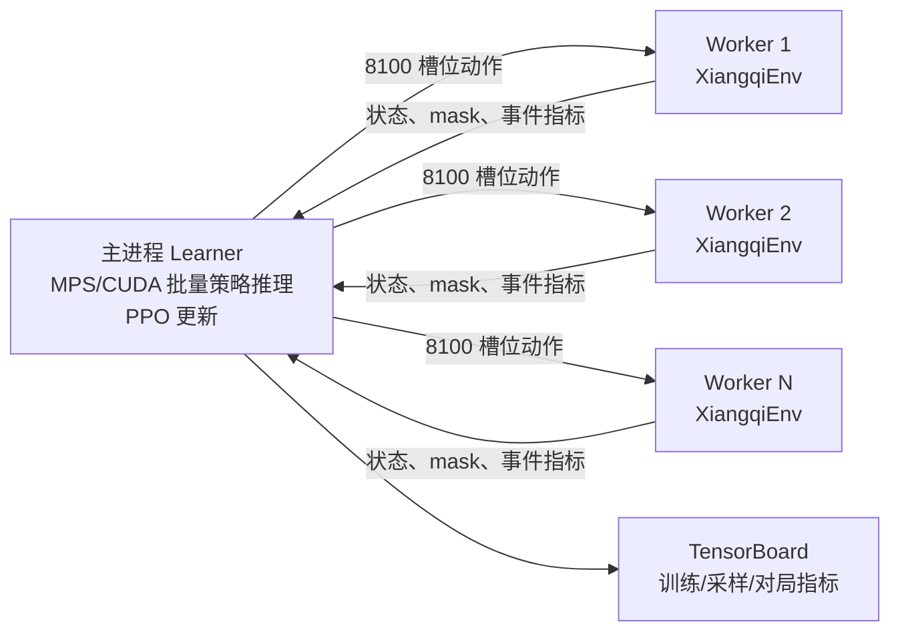

# 中国象棋 PPO：状态、动作与网络结构

## 输入与动作

- **状态**：`[B, 16, 10, 9]`，视角固定为当前行棋方在底部、向上进攻。
- **状态平面**：己方 7 类棋子、敌方 7 类棋子、己方受将、敌方受将。
- **动作**：固定 `90 × 90 = 8100` 个起点—终点槽位；合法着法由动作掩码保留。

## 网络图

```mermaid
flowchart TD
    S[状态张量\nB × 16 × 10 × 9] --> STEM[Stem\n3×3 Conv 16→128\nGroupNorm + SiLU]
    STEM --> R1[Residual Block × 6\n每块：3×3 Conv + GN + SiLU\n3×3 Conv + GN + Skip + SiLU]

    R1 --> PH[策略头投影\n1×1 Conv 128→64\nGN + SiLU]
    PH --> TOK[空间 Token\nB × 90 × 64]
    TOK --> Q[起点 Query\nLinear 64→64]
    TOK --> K[终点 Key\nLinear 64→64]
    TOK --> FB[起点 Bias\nLinear 64→1]
    TOK --> TB[终点 Bias\nLinear 64→1]
    Q --> PAIR[Q · Kᵀ / √64\nB × 90 × 90]
    K --> PAIR
    FB --> LOGITS[配对动作 Logits\nB × 8100]
    TB --> LOGITS
    PAIR --> LOGITS
    LOGITS --> MASK[合法动作 Mask\n非法动作 = -∞]
    MASK --> PI[Categorical π(a|s)]

    R1 --> VH[价值头\n1×1 Conv 128→64\nGN + SiLU]
    VH --> GAP[Global Average Pool]
    GAP --> MLP[Linear 64→256 + SiLU\nLinear 256→1]
    MLP --> V[状态价值 V(s)]
```

## 策略头的起终点配对

对于每个棋盘格生成一个起点向量 \(q_i\) 和终点向量 \(k_j\)：

\[
L_{i,j} = \frac{q_i \cdot k_j}{\sqrt{64}} + b^{from}_i + b^{to}_j
\]

其中 \(i,j \in [0,89]\)。最终将 \(90 \times 90\) 的得分展平为 8100 维动作 logits，再由合法动作掩码排除非法棋。

相较于普通的 `Linear(..., 8100)`，这个结构显式学习“哪个棋子适合从哪里走到哪里”的关联，同时减少扁平分类头的参数冗余。

## 多进程采样架构



默认使用 8 个 `spawn` 子进程，每个环境采样 128 个半回合；一次 PPO 更新合并为 \(8 \times 128 = 1024\) 个局面。子进程只执行 Python 规则、合法走法生成和环境转移，主进程对整批状态在 MPS/CUDA 上进行一次策略推理，因此不会在子进程中争抢 GPU/MPS。

## PPO 训练约定

每一步状态都以当前行棋方为己方。下一状态轮到对手，其价值是当前玩家收益的相反数，因此一阶 TD 残差为：

\[
\delta_t = r_t - \gamma V(s_{t+1}) - V(s_t)
\]

普通吃子不再提供材料奖励，主要依靠终局 \(+1\) 胜、\(0\) 非终局/截断奖励，避免策略过度贪子而忽略攻杀与弃子战术。
